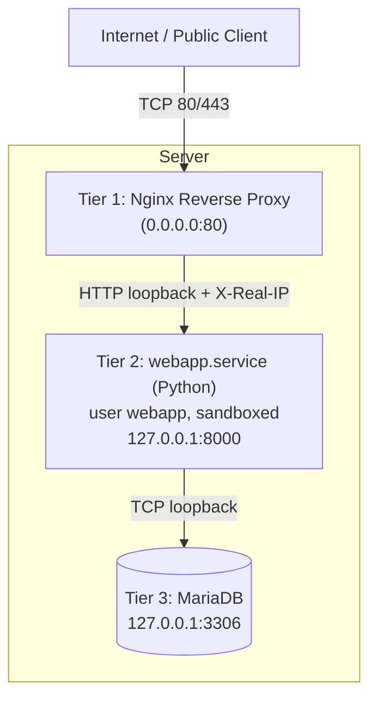

# Enterprise Multi-Tier Web Stack — UK5 Milestone 2

Praktikum Sistem Operasi (21163120217) · Sekolah Vokasi UNS
Otomasi penuh stack **Nginx → Backend Python (systemd) → MariaDB** dengan satu perintah, idempoten, dan di-sandbox.

> **Anggota tim:** _(isi nama & NIM)_ · **Kelas/Kelompok:** _(isi)_

## Arsitektur



```
[ Client ] --80/443--> [ Nginx ] --127.0.0.1:8000--> [ webapp.service ] --127.0.0.1:3306--> [ MariaDB ]
   publik                 publik                      loopback only                          loopback only
```

| Prinsip | Implementasi |
|---|---|
| Isolasi layanan | MariaDB `bind-address=127.0.0.1`, port 3306 tidak dibuka di firewall; backend hanya listen di loopback |
| Least privilege | Backend berjalan sebagai user sistem `webapp` (`nologin`), `NoNewPrivileges`, `CapabilityBoundingSet=` kosong |
| Idempotensi | Semua langkah memeriksa state sebelum bertindak; service hanya di-restart bila konfigurasi benar-benar berubah |
| Zero hardcoded credentials | Secret dari `.env` (0600) → `/etc/webapp/webapp.env` (root, 0600) → `EnvironmentFile` systemd |

## Quick Start

```bash
git clone <url-repo> && cd project-root
./deploy.sh --init-env     # buat .env dengan password DB acak (atau: cp env.example .env && chmod 600 .env)
./deploy.sh --check        # opsional: validasi .env & distro, tanpa mengubah sistem
./deploy.sh                # deploy penuh; aman diulang (sudo otomatis bila perlu)
./tests/health_check.sh    # smoke test; tambahkan --self-heal untuk uji kill -9
```

Distro yang didukung: Ubuntu/Debian (apt) dan RHEL family — Rocky, AlmaLinux, Fedora (dnf), terdeteksi dari `/etc/os-release`.

## Struktur Repositori

```
project-root/
├── README.md
├── deploy.sh                    # Master installer (strict mode, trap, lock, orkestrasi)
├── env.example                  # Template environment variable
├── app/app.py                   # Backend tier 2 (stdlib + PyMySQL)
├── systemd/webapp.service       # Custom unit + sandboxing
├── configs/
│   ├── nginx.conf.template      # Reverse proxy (dirender envsubst)
│   └── database.cnf             # Hardening MariaDB
├── scripts/
│   ├── lib.sh                   # Logging, trap, deteksi distro, validasi env, helper idempoten
│   ├── 01_setup_users.sh        # User/group/direktori
│   ├── 02_install_deps.sh       # Paket (apt/dnf, non-interaktif)
│   ├── 03_configure_sec.sh      # Firewall (ufw/firewalld) & SELinux boolean
│   └── 04_deploy_stack.sh       # DB, app, unit systemd, nginx
└── tests/
    ├── health_check.sh          # Smoke test + uji self-healing
    └── idempotency_test.sh      # Jalankan deploy 2x & bandingkan state
```

## Fitur Robust Bash

- `set -Eeuo pipefail` + `IFS=$'\n\t'`; `-E` membuat trap `ERR` berlaku juga di dalam fungsi.
- `trap ERR` melaporkan perintah, exit code, file:baris; `trap INT TERM` keluar dengan kode 130; `trap EXIT` membersihkan direktori temporer.
- `flock` mencegah dua deploy berjalan bersamaan.
- Validasi input `.env` (nama DB/user, port, panjang password, DB_HOST harus loopback) sebelum menyentuh sistem.
- Password SQL di-escape dan dikirim via stdin (tidak tampil di `ps`).
- Config nginx divalidasi dengan `nginx -t`; bila gagal, versi lama dipulihkan otomatis.
- Modul dapat dijalankan mandiri, mis. `sudo scripts/01_setup_users.sh`.

## Hardening Systemd

`ProtectSystem=strict`, `ProtectHome`, `PrivateTmp`, `PrivateDevices`, `NoNewPrivileges`, `RestrictSUIDSGID`, `RestrictAddressFamilies`, `SystemCallFilter=@system-service`, `ReadWritePaths` hanya `data/` dan `/var/log/webapp`, plus `Restart=always` (`RestartSec=5s`).
Audit: `systemd-analyze security webapp.service`.

## Bukti Pengujian (isi saat sprint review)

| Uji | Perintah | Hasil / Screenshot |
|---|---|---|
| Idempoten 2x | `sudo ./tests/idempotency_test.sh` | _(lampirkan `tests/evidence/`)_ |
| Smoke test | `./tests/health_check.sh --self-heal` | _(lampirkan)_ |
| Skor sandbox | `systemd-analyze security webapp.service` | _(lampirkan)_ |
| Dependensi | `systemctl list-dependencies webapp.service` | _(lampirkan)_ |
| Distro Debian-family | Ubuntu 22.04/24.04 | _(OS & tanggal)_ |
| Distro RHEL-family | Rocky/Alma 9 | _(OS & tanggal)_ |

## Troubleshooting

- Backend gagal start: `journalctl -u webapp.service -n 50`.
- Status 226/NAMESPACE: pastikan direktori `ReadWritePaths` ada (dibuat modul 01).
- RHEL/SELinux: `ausearch -m avc -ts recent`; boolean `httpd_can_network_connect` diatur modul 03.
- Ubah password DB: edit `.env`, jalankan ulang `./deploy.sh` (user DB, env runtime, dan service diperbarui).

## Alur Git (saran)

Satu branch per modul/anggota (`feat/01-users`, `feat/systemd-unit`, `feat/nginx`, ...), Pull Request ke `main`, commit kecil dan bermakna agar kontribusi tiap anggota terlihat di `git shortlog -sn`.
